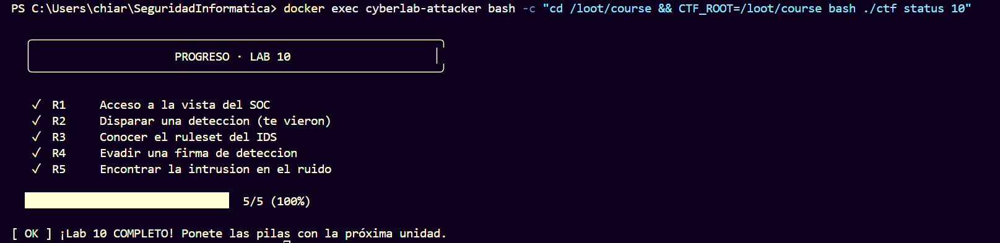

# Informe — Laboratorio 10 · Detección y evasión

**Grupo:** 10 · **Fecha:** 30/10/2026

| Integrante | Legajo | GitHub |
|---|---:|---|
| Belén Rocío Ramello | 15226 | [@belramello](https://github.com/belramello) |
| Carolina Paula Corazza | 15239 | [@carocor1](https://github.com/carocor1) |
| Chiara Agustina Kordek | 14719 | [@chiarakordek](https://github.com/chiarakordek) |
| Juan Pablo Saby | 15026 | [@JuanSaby](https://github.com/JuanSaby) |

## 0. Declaración de uso de IA

Se consultó Codex para aclarar dudas sobre detección por firmas y evasión, y
recibir apoyo puntual en la preparación de partes del informe y la
mini-research. Las peticiones, respuestas, alertas y flags se comprobaron en el
entorno local por el grupo.

## 1. Flags capturadas

Se obtuvieron en PhantomCorp local y las cinco fueron aceptadas por el verificador oficial:

| Reto | Flag | Evidencia resumida |
|---|---|---|
| R1 | `FLAG{soc_log_access}` | Acceso a `GET /soc`. |
| R2 | `FLAG{detection_triggered}` | `GET /` con `User-Agent: sqlmap`; HTTP 403 y alerta `scanner-ua`. |
| R3 | `FLAG{signature_ruleset}` | Consulta a `GET /soc/reglas`. |
| R4 | `FLAG{signature_evaded}` | `GET /api?q=UNION%2F%2A%2A%2FSELECT`; procesado como benigno, sin alerta de firma. |
| R5 | `FLAG{intrusion_in_the_noise}` | Línea preexistente de `/soc` con `ALERT[path-traversal]` y origen no atribuido. |

Salida resumida de `./ctf status 10`:

```text
R1 ✓  Acceso a la vista del SOC
R2 ✓  Disparar una deteccion (te vieron)
R3 ✓  Conocer el ruleset del IDS
R4 ✓  Evadir una firma de deteccion
R5 ✓  Encontrar la intrusion en el ruido
5/5 (100%) — Lab 10 COMPLETO
```



## 2. Tabla de firmas

| Firma | Cómo se evade (observado) | Cómo se mejora la detección |
|---|---|---|
| `scanner-ua` | `curl -A sqlmap http://phantomcorp/` recibió HTTP 403 y el cuerpo indicó que se disparó `scanner-ua`. La regla confía en una cadena del encabezado que el cliente controla; cambiar la UA puede evitar esa condición concreta. | Tratar User-Agent como señal, no identidad; correlacionar ritmo, rutas, parámetros, respuestas, sesión y origen. Aplicar límites y conservar contexto para análisis. |
| `sqli-union` | Envié `q=UNION/**/SELECT` a `/api`. El servidor respondió `200 OK (procesado como benigno)`: el comentario sustituyó el espacio requerido por la firma y la petición no fue detectada. | Canonicalizar/normalizar comentarios y codificaciones antes de detectar; preferir análisis sintáctico o reglas tokenizadas y probar variaciones benignas/maliciosas. En la aplicación, usar consultas parametrizadas; una firma aislada no es garantía. |

## 3. Preguntas P1–P5

**P1. ¿Por qué la detección por firmas es evadible por diseño y qué la complementa?** Una firma busca una condición concreta en los eventos. Si el atacante cambia la representación sin cambiar el sentido de la solicitud, una regla literal puede no coincidir. Las firmas son útiles para patrones conocidos y alertas claras, pero deben complementarse con normalización, detección basada en comportamiento/anomalías, correlación de eventos y análisis de una persona. Cada fuente tiene límites y falsos positivos; el contexto importa.

**P2. Reescribir la regla `sqli-union` para que no se evada con `/**/`. ¿Existe una firma perfecta?** Como mejora mínima, normalizar la entrada (decodificar una sola vez según el protocolo, canonicalizar mayúsculas/minúsculas y comentarios SQL) antes de aplicar la regla. Si se usa una regex, aceptar uno o más separadores compuestos por espacios o comentarios, por ejemplo conceptualmente `(?i)\bunion(?:\s|/\*.*?\*/)+select\b`, con límites de longitud y pruebas contra entradas benignas. Un parser SQL/contexto del parámetro es más sólido que depender de una sola cadena. No hay una firma perfecta: distintas codificaciones, gramáticas y contextos de aplicación producen falsos positivos y evasiones. Las consultas parametrizadas reducen la vulnerabilidad en origen.

**P3. ¿Por qué detectar por User-Agent es débil y qué mirar en su lugar?** El cliente controla el encabezado y puede imitar un navegador. La User-Agent es una señal útil, no una identidad autenticada. Conviene evaluar frecuencia y distribución de requests, secuencias de rutas, métodos, parámetros, respuestas 4xx/5xx, sesión, origen y cambios de comportamiento, correlacionando señales antes de bloquear.

**P4. ¿Qué habría hecho que la intrusión del R5 se detectara automáticamente?** Una regla de correlación aplicada a los logs podría alertar por una combinación inusual —por ejemplo, una solicitud con patrón de traversal seguida por acceso exitoso a una ruta sensible— y priorizar el evento para investigación. Para que funcione, la aplicación debe registrar los campos necesarios, los relojes deben ser comparables, los logs deben centralizarse y la regla debe probarse para controlar falsos positivos. Una alerta no reemplaza validar el incidente.

**P5. ¿Por qué Red y Blue necesitan entenderse?** El conocimiento ofensivo ayuda a anticipar variaciones de solicitudes y a probar si las reglas detectan la conducta, no solo una cadena. El conocimiento defensivo permite al equipo Red medir qué evidencia genera su actividad y evitar conclusiones basadas únicamente en que una petición fue bloqueada. En ambos casos, entender el otro lado ayuda a diseñar controles y pruebas más realistas.

## 4. Bitácora

| Reto | Petición/acción real | Resultado observado |
|---|---|---|
| R1 | `curl http://phantomcorp/soc` | Vista SOC accesible; mostró los eventos y la pista de una intrusión no atribuida. |
| R2 | `curl -A sqlmap http://phantomcorp/` | HTTP 403; cuerpo con alerta `scanner-ua` y R2. |
| R3 | `curl http://phantomcorp/soc/reglas` | Publicó las reglas activas, incluida `sqli-union` con espacio requerido. |
| R4 | `curl -G --data-urlencode 'q=UNION/**/SELECT' http://phantomcorp/api` | HTTP 200; indicó “procesado como benigno” y devolvió R4. |
| R5 | `curl http://phantomcorp/soc` y filtrado de `ALERT` | Intrusión: `185.220.101.42 - GET /admin/../../etc/passwd 200 ALERT[path-traversal] # intrusion no atribuida`; devolvió R5. |

El verificador oficial aceptó las cinco flags: **R1–R5 ✓, 5/5 (100%)**.
